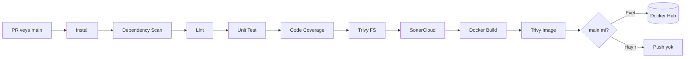

# E2E DevOps Platform

[](https://sonarcloud.io/dashboard?id=mustafaogur_todo-backend&branch=main)
[](https://sonarcloud.io/dashboard?id=mustafaogur_todo-frontend&branch=main)

Uçtan uca bir DevOps platformu kurma projesi. Uygulama bilerek basit tutuldu; odak noktası uygulamanın test edilmesi, taranması, paketlenmesi ve yayınlanması.

> **Durum:** Uygulama, container'lar ve CI hattı tamamlandı. Sırada Kubernetes cluster'ı ve GitOps ile CD var.

## CI Hattı

`main`'e giden her PR ve `main`'e yapılan her merge, Docker içinde çalışan Jenkins üzerinde şu hattan geçer. Backend ve frontend paralel ilerler:



- Image'lar kısa commit SHA ile etiketlenir, `latest` kullanılmaz: [todo-backend](https://hub.docker.com/r/mustafaoqr/todo-backend), [todo-frontend](https://hub.docker.com/r/mustafaoqr/todo-frontend).
- `main` korumalıdır; değişiklikler PR ile ve Jenkins kontrolü geçtikten sonra alınır.
- Test, coverage ve güvenlik raporları JUnit XML, Cobertura XML ve JSON olarak yayınlanır.

### Pipeline ne zaman çalışır?

Pipeline, Jenkins'te **Multibranch Pipeline** job'ı olarak tanımlıdır ve `ci/Jenkinsfile` dosyasını kullanır. Jenkins yerel makinede çalıştığı için GitHub webhook'u kullanılmaz; Jenkins repoyu 2 dakikada bir tarar ve yeni commit bulursa pipeline'ı kendisi başlatır.

| Olay | Pipeline | Image push |
|------|----------|------------|
| PR yokken feature branch'e push | Çalışmaz | Hayır |
| PR açılması veya PR'a yeni commit | Çalışır | Hayır |
| PR'ın `main`'e merge edilmesi | Çalışır | Evet |

Bunu job'daki `main PR-*` branch filtresi sağlar. Jenkins kapalıyken yapılan değişiklikler, Jenkins açıldığında ilk taramada bulunur ve son commit için build alınır. PR'lar `continuous-integration/jenkins/pr-head` kontrolü geçmeden merge edilemez.

## Teknolojiler

| Alan | Araçlar |
|------|---------|
| Frontend | React, Vite, Nginx |
| Backend | FastAPI, SQLAlchemy, Alembic |
| Veritabanı | PostgreSQL |
| Container | Docker, Docker Compose |
| CI | Jenkins |
| Test ve lint | pytest, Vitest, React Testing Library, Ruff, ESLint |
| Kod kalitesi ve güvenlik | SonarCloud, Trivy, pip-audit, npm audit |
| Registry | Docker Hub |

## Hızlı Başlangıç

Gereksinim: Docker

```bash
cd app
docker compose up --build
```

| Adres | İçerik |
|-------|--------|
| http://localhost:3000 | Uygulama |
| http://localhost:8000/docs | API dokümanı |

Durdurmak için `docker compose down`, veritabanını da silmek için `docker compose down -v`.

## Geliştirme

Gereksinimler: Python 3.13, Node.js 24, Docker

```bash
# Veritabanı
docker run --name todo-db -e POSTGRES_USER=todo -e POSTGRES_PASSWORD=todo \
  -e POSTGRES_DB=todo -p 5432:5432 -d postgres:18-alpine

# Backend
cd app/backend
python -m venv .venv
source .venv/bin/activate      # Windows: .venv\Scripts\Activate.ps1
pip install -r requirements-dev.txt
cp .env.example .env
alembic upgrade head
uvicorn app.main:app --reload --port 8000

# Frontend (ayrı terminalde)
cd app/frontend
npm install
npm run dev                    # http://localhost:5173
```

### Test ve lint

Unit testler veritabanı veya çalışan bir backend gerektirmez. Coverage %80'in altına düşerse komut hata verir.

```bash
# app/backend
ruff check .
pytest --cov

# app/frontend
npm run lint
npm run test:coverage
```

## Jenkins'i Çalıştırma

```bash
cd ci/jenkins
docker compose up --build -d
```

Jenkins http://localhost:8080 adresinde açılır. İlk kurulumdan sonra gereken ayarlar:

| Ayar | Değer |
|------|-------|
| Credential'lar | `github-credentials`, `dockerhub-credentials`, `sonar-token` |
| Job türü | Multibranch Pipeline |
| Branch source | GitHub, fork PR keşfi kapalı |
| Script Path | `ci/Jenkinsfile` |
| Tarama | Periodically if not otherwise run, 2 dakika |
| Filter by name | `main PR-*` |

## Repo Yapısı

```text
app/
├── backend/            FastAPI uygulaması, migration'lar, testler, Dockerfile
├── frontend/           React uygulaması, testler, Dockerfile, Nginx ayarı
└── docker-compose.yml  3 katmanı birlikte çalıştıran yerel ortam
ci/
├── Jenkinsfile         CI hattı
└── jenkins/            Jenkins image'ı, plugin listesi, Compose dosyası
```
